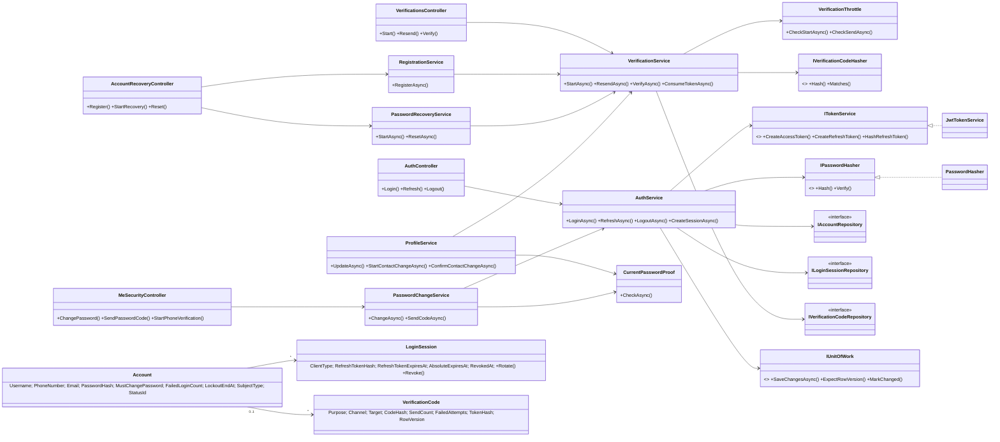
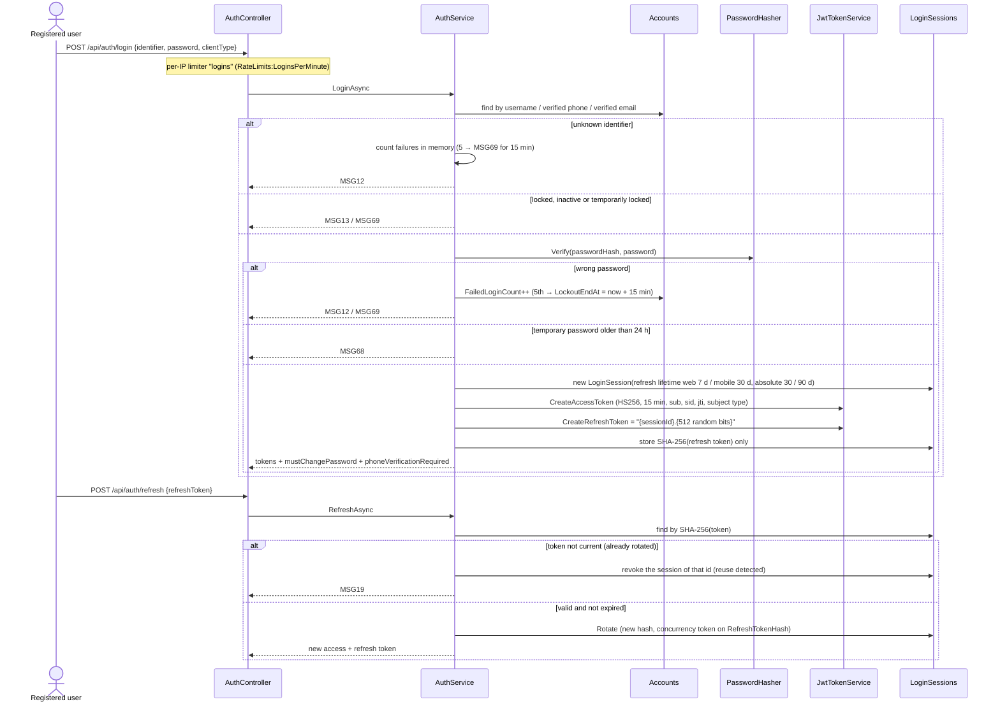
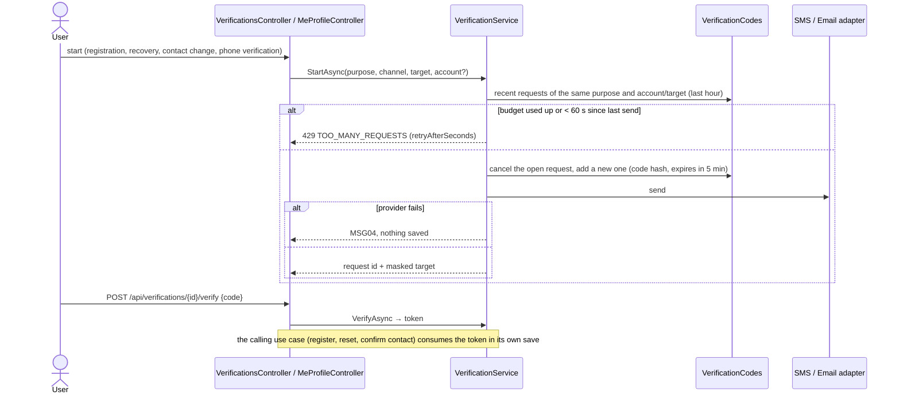

# OMTS SDS v1.1 – AUTH, COOP and ADMIN detailed design

Report 4 (Software Design Specification) part for the account, cooperative and platform-administration
modules, written from the backend code (branches OMTS-208, OMTS-200, OMTS-198, OMTS-199; PRs #5–#8,
including the fixes of their 23/10 reviews). Keep it updated in the PRs that change these modules.

| Old UC (SRS v5.8) | SRS 22/10 §I.4 | Backend |
|---|---|---|
| UC01 Register trader account | ACS-01 | `RegistrationService` |
| UC02 Log in | ACS-02 | `AuthService`, `AccountStateGateFilter` |
| UC03 Self-service account recovery | ACS-03 | `PasswordRecoveryService` |
| UC04 Change password | ACS-04 | `PasswordChangeService` |
| UC05 Update personal profile | ACS-05 | `ProfileService`, `PhoneVerificationService` |
| UC06/UC07 Notification settings and devices | ACS-07 | `NotificationPreferenceService`, `PushDeviceService` |
| UC08 Verify email or phone number | ACS-06 | `VerificationService` |
| UC09 Manage cooperative profile | FARM-01 | `CooperativeProfileService` |
| UC10 Manage employee profiles | LAB-01 | `EmployeeService` |
| UC11 Manage user accounts and zone-based access | ACS-09, FARM-05 | `StaffAccountService`, `AccessGrantService` |
| UC12 Manage roles and permissions | ACS-10 | `RoleService`, `PermissionFunctions` |
| UC72 Grant initial Cooperative Owner access | deployment (not a UC since 22/10) | `DeploymentBootstrapper` (`seed --bootstrap`) |

## 1. Architecture of the modules

Clean Architecture, one ASP.NET Core 8 API:

- **OMTS.Domain**: entities, enums, status ids. No dependencies.
- **OMTS.Application**: use-case services returning `Result<T>`, interfaces of repositories and adapters, business rules, `UserMessages` (SRS MSG codes).
- **OMTS.Infrastructure**: EF Core 8 (SQL Server) repositories, unit of work, interceptors, JWT/PBKDF2, adapters (SMTP email, SMS/push fakes, file storage), bootstrap command, health checks.
- **OMTS.Api**: controllers (thin: bind request → call service → `ToActionResult`), filters, rate limiting, problem details.

Each use case runs in one HTTP request scope: the services of the request share one `OmtsDbContext`, and a single `IUnitOfWork.SaveChangesAsync` commits the change, its audit rows and in-app notifications together. Push messages are sent only after the commit.

## 2. Class diagrams

### 2.1 AUTH (ACS-01…ACS-07)



### 2.2 COOP and access control (FARM-01, LAB-01, ACS-09, ACS-10, FARM-05) and ADMIN bootstrap

```mermaid
classDiagram
    direction LR
    class CooperativeProfileService { +GetAsync() +UpdateAsync() +UploadLogoAsync() +RemoveLogoAsync() +OpenLogoAsync() +OpenLogoFileAsync() }
    class EmployeeService { +SearchAsync() +LinkableAccountsAsync() +CreateAsync() +UpdateAsync() +EndEmploymentAsync() +ReinstateAsync() +CreateAccountAsync() }
    class StaffAccountService { +CreateAsync() +UpdateAsync() +LockAsync() +UnlockAsync() +ResetPasswordAsync() +RefuseOtherSubjectType() }
    class AccessGrantService { +GrantAsync() +RevokeAsync() +PreviewAsync() }
    class RoleService { +CreateAsync() +UpdateAsync() +CopyAsync() +DiscontinueAsync() +ImpactAsync() }
    class PermissionService { +GetAccessAsync() }
    class AccountAccess { +IsCooperativeOwner +Allows() +PermittedZonesFor() +DescribeFunctions() }
    class PermissionCache
    note for PermissionCache "5 minutes, key carries a version bumped on every grant, role or account change"
    class RequirePermissionAttribute { Function; Action; Scope }
    class RequireCooperativeOwnerAttribute
    class AuditLogService { +Record() +RecordStatusChange() }
    class DeploymentBootstrapper { +RunAsync(seedDemoData) }
    class Cooperative { FullName; TaxCode; OfficeAddress; LogoUrl; BankAccount; StatusId }
    class Employee { FullName; PhoneNumber; AccountId; EmploymentEndDate; BankAccount; StatusId }
    class Role { Name; StatusId }
    class RolePermission { FunctionCode; CanView; CanCreate; CanEdit; CanDelete; OtherPermissions }
    class AccessGrant { AccountId; RoleId; ZoneId; ScopeType; EffectiveFrom; EffectiveTo; RevokedAt }
    EmployeeService --> StaffAccountService : ACS-09 extends LAB-01
    StaffAccountService --> AccessGrantService
    AccessGrantService --> PermissionService : preview uses AccountAccess
    PermissionService --> PermissionCache
    PermissionService --> AccountAccess
    RequirePermissionAttribute --> PermissionService
    RequireCooperativeOwnerAttribute --> PermissionService
    CooperativeProfileService --> AuditLogService
    EmployeeService --> AuditLogService
    RoleService --> AuditLogService
    DeploymentBootstrapper --> Cooperative
    Cooperative "1" --> "*" Employee
    Employee "0..1" --> "0..1" Account
    Role "1" --> "*" RolePermission
    Account "1" --> "*" AccessGrant
    Role "1" --> "*" AccessGrant
```



## 3. Sequence diagrams

### 3.1 UC02 / ACS-02 – Log in and refresh



After login every request passes `AccountStateGateFilter`: an account that must change its temporary password reaches only the password endpoints (`PASSWORD_CHANGE_REQUIRED`). A trader or staff member without a verified phone reaches only the phone verification endpoints (MSG67, ACS-06 extends ACS-02).

### 3.2 UC03 / ACS-03 – Recover password

```mermaid
sequenceDiagram
    actor U as Registered user
    participant C as AccountRecoveryController
    participant R as PasswordRecoveryService
    participant V as VerificationService
    participant M as SMS / Email adapter
    participant S as AuthService
    U->>C: POST /api/auth/recovery {identifier, channel}
    C->>R: StartAsync
    R->>V: StartAsync(AccountRecovery, account, verified target)
    Note over V: budget per purpose + account/target: 5 sends/hour, 60 s apart, 10 wrong entries/hour → MSG69
    V->>M: send 6-digit code (stored as SHA-256(id:code), valid 5 min)
    R-->>C: 202 MSG15 + request id (same answer for unknown, locked or unverified identifiers)
    U->>C: POST /api/verifications/{id}/verify {code}
    C->>V: VerifyAsync
    alt wrong code
        V->>V: FailedAttempts++ (re-counted after a rowversion conflict; 5th locks the request)
        V-->>C: MSG16
    else correct
        V-->>C: single-use token (10 min, stored hashed)
    end
    U->>C: POST /api/auth/recovery/reset {token, newPassword}
    C->>R: ResetAsync
    R->>V: ConsumeTokenAsync(AccountRecovery)
    R->>R: password policy, new PBKDF2 hash, clear temporary password and lockout
    R->>S: revoke every session of the account
    R-->>C: MSG18 (audit "Account.PasswordReset", no secret in it)
```

Recovery codes cannot be resent: a new start is needed, so a request id never tells whether an account exists.

### 3.3 UC08 / ACS-06 – Verify contact information



### 3.4 UC11 / ACS-09 + FARM-05 – Manage staff accounts and zone access

```mermaid
sequenceDiagram
    actor O as Cooperative Owner
    participant F as RequireCooperativeOwner filter
    participant A as StaffAccountService
    participant G as AccessGrantService
    participant P as PermissionService
    participant U as UnitOfWork
    participant I as PermissionCacheInvalidationInterceptor
    O->>F: POST /api/accounts {username, phone, email, grants[]}
    F->>P: GetAccessAsync(caller) → IsCooperativeOwner?
    F->>A: CreateAsync
    A->>A: validate (MSG01), unique username/phone (MSG03), ≥ 1 grant, no Owner rights (403 + audit)
    A->>G: add zone–role grants (role In Use, zone In Use, no overlap → MSG03)
    A->>A: 10-character temporary password, PBKDF2 hash, expires in 24 h
    A->>U: SaveChangesAsync (account + grants + audit rows)
    U->>I: grants or roles saved → bump the permission cache version
    A-->>O: account + temporary password (returned once, never logged or audited)
    O->>A: POST /api/accounts/{id}/lock {reason}
    A->>U: status Locked, revoke all sessions, audit (reason)
    O->>G: POST /api/accounts/{id}/grants/{grantId}/revoke {reason}
    G->>U: RevokedAt, audit; next request of that staff member reads the new permissions
```

## 4. Database tables

SQL Server, code-first EF Core migrations. Every business table derives from `AuditableEntity`: `Id` uniqueidentifier, `CreatedAt`/`CreatedBy`, `UpdatedAt`/`UpdatedBy` (stamped by `AuditableEntityStampInterceptor`), and `RowVersion` rowversion (optimistic concurrency, MSG06). Foreign keys never cascade.

| Table | Main columns | Keys / indexes |
|---|---|---|
| Accounts | DisplayName, Username, PhoneNumber, PhoneVerifiedAt, Email, EmailVerifiedAt, PasswordHash, MustChangePassword, TemporaryPasswordIssuedAt, FailedLoginCount, LockoutEndAt, LastLoginAt, SubjectType (CooperativeOwner, Staff, Trader), StatusId, NotificationPreferences (JSON) | unique Username; unique PhoneNumber; unique Email where verified |
| LoginSessions | AccountId, ClientType (Web, Mobile), RefreshTokenHash, RefreshTokenExpiresAt, AbsoluteExpiresAt, LastRefreshedAt, RevokedAt, RevokeReason, DeviceName, UserAgent, IpAddress | unique RefreshTokenHash (concurrency token) |
| VerificationCodes | AccountId?, Purpose, Channel, Target, CodeHash, ExpiresAt, LastSentAt, SendCount, FailedAttempts, ConsumedAt, CancelledAt, TokenHash, TokenExpiresAt, TokenConsumedAt, RowVersion | unique TokenHash; (Target, Purpose, CreatedAt); (AccountId, Purpose) |
| PushDevices | AccountId, Token, Platform, PermissionGranted, RegisteredAt, LastSeenAt | unique Token |
| Roles | Name, Description, StatusId (In Use / Discontinued) | unique Name |
| RolePermissions | RoleId, FunctionCode (catalog `PermissionFunctions`), CanView, CanCreate, CanEdit, CanDelete, OtherPermissions (Export, Publish), DataScope | RoleId |
| AccessGrants | AccountId, RoleId, ZoneId (null = All zones), ScopeType, EffectiveFrom, EffectiveTo, GrantedByAccountId, RevokedAt, RevokedByAccountId, RevokeReason, StatusId | (AccountId, StatusId) |
| Cooperatives | FullName, TaxCode, OfficeAddress, PhoneNumber, Email, Website, LegalRepresentative, BusinessLines (JSON), LogoUrl, BankAccount (owned), StatusId (Preliminary / Completed) | unique TaxCode |
| Employees | CooperativeId, FullName, PhoneNumber, AccountId?, Birthday, Address, Area, Ward, OtherInformation, Notes, EmploymentEndDate, BankAccount (owned), StatusId | unique (FullName, PhoneNumber); unique AccountId |
| EmployeeWorkingZones | EmployeeId, ZoneId | primary key (EmployeeId, ZoneId) |
| AuditEvents | ActorAccountId, Action, RecordType, RecordId, RecordCode, OccurredAt, Reason, Before (JSON), After (JSON), ZoneId | (RecordType, RecordId); OccurredAt; (ZoneId, OccurredAt) |
| Notifications | RecipientAccountId, Type, Title, Body, RelatedRecordType, RelatedRecordCode, CreatedAt, ReadAt, IsMandatory | (RecipientAccountId, ReadAt) |
| Statuses / StatusTransitions | fixed catalog seeded by migrations (SRS Table 3.4-1 / 3.4-2) | unique (Group, Code) |

## 5. API list

All routes are JSON over HTTPS. Errors are `application/problem+json` with `code` = MSGxx and the SRS text in `detail`. Enum values are names (e.g. `"Staff"`).

| Method and route | Access | UC |
|---|---|---|
| POST /api/auth/login | anonymous, per-IP limit | ACS-02 |
| POST /api/auth/refresh | anonymous (refresh token) | ACS-02 |
| POST /api/auth/logout | signed in | ACS-02 |
| POST /api/verifications | anonymous, per-IP limit | ACS-06 (registration) |
| POST /api/verifications/{id}/resend, /verify | anonymous or signed in, per-IP limit | ACS-06 |
| POST /api/auth/register | anonymous, per-IP limit | ACS-01 |
| POST /api/auth/recovery, /api/auth/recovery/reset | anonymous, per-IP limit | ACS-03 |
| POST /api/me/password; POST /api/me/password/code (per-IP limit) | signed in | ACS-04 |
| POST /api/me/phone-verification (per-IP limit, unverified phone only), /confirm | signed in | ACS-02 branch, ACS-06 |
| GET/PUT /api/me/profile; POST /api/me/contact-changes (current password, per-IP limit), /confirm | signed in | ACS-05 |
| GET/PUT /api/me/notification-preferences; POST/DELETE /api/me/devices | signed in | ACS-07 |
| GET /api/me/permissions | signed in | menus, dashboard tiles |
| GET/POST /api/accounts; GET/PUT /api/accounts/{id}; POST …/lock, …/unlock, …/reset-password | Cooperative Owner | ACS-09 |
| GET/POST /api/accounts/{id}/grants; POST …/grants/{grantId}/revoke; POST /api/accounts/permission-preview | Cooperative Owner | FARM-05 |
| GET /api/permission-functions; GET/POST /api/roles; GET/PUT /api/roles/{id}; POST …/copy, …/discontinue, …/reactivate; GET …/impact | Cooperative Owner | ACS-10 |
| GET/PUT /api/cooperative/profile; POST/DELETE /api/cooperative/profile/logo | Cooperative Owner | FARM-01 |
| GET /api/public/cooperative/logo (current logo); GET /api/public/cooperative/logos/{yyyy}/{MM}/{file} (one logo file, the URL the profile returns and a published version stores) | anonymous | provenance page |
| GET/POST /api/employees; GET /api/employees/linkable-accounts; GET/PUT /api/employees/{id}; POST …/account, …/end-employment, …/reinstate | Cooperative Owner | LAB-01, ACS-09 |
| GET /api/files/local/{key} | signed, expiring URL | file downloads (Local storage) |
| GET /health (liveness), /health/db (database + migrations, for platform probes), /health/ready (post-deployment verification) | anonymous | deployment |
| `dotnet OMTS.Api.dll seed --bootstrap [--demo]` | deployment command | cooperative + first Owner (old UC72) |

## 6. Security mechanisms (NFR-01)

| Concern | Mechanism |
|---|---|
| Passwords | ASP.NET Core Identity `PasswordHasher` (PBKDF2, per-password salt, versioned format, rehash on success when the format is old). Policy checked by `PasswordPolicy`. Never logged or audited. |
| Temporary passwords | 10 random characters, valid 24 h, must be changed at first login (`MustChangePassword`); returned once in the create/reset response only. |
| Login throttling | 5 wrong passwords → 15-minute lock (`LockoutEndAt`); unknown identifiers counted the same way in a dedicated, size-limited memory cache (`UnknownLoginCounter`), and a locked account takes the same hashing time as a locked unknown identifier. Identifier (254) and password (128) are length-limited before any hashing or query. Per-IP fixed-window limiter on login (default 30/min). A wrong current password in ACS-04 and ACS-05 counts too. |
| Access token | JWT HS256, 15 minutes, 30 s clock skew; claims: subject (account id), session id, token id, username, subject type. Permissions are not in the token: they are read per request (cached 5 min, invalidated on every grant/role/account change), so role edits apply at once. The signing key comes from configuration (user-secrets / pipeline secret), at least 32 bytes. |
| Refresh token / sessions | One `LoginSession` per login; refresh token = `{sessionId}.{512 random bits}.{HMAC}`, stored as SHA-256 only; the HMAC proves the server issued it, so a made-up token naming a session cannot end it. Each refresh rotates it; reuse of an old token revokes the session. Web 7 d sliding / 30 d absolute, mobile 30 d / 90 d. Logout revokes the session; password change, reset and lock revoke all sessions. |
| Verification codes | 6 digits from a CSPRNG, stored as HMAC-SHA256(requestId:code) with a server key (`IVerificationCodeHasher`), compared in constant time; valid 5 min, 5 wrong entries lock the request, at most 3 sends 60 s apart per request and 5 per hour per purpose + account/target, 10 wrong entries per hour → MSG69. `VerificationThrottle` adds 10 sends per hour to one number or address across accounts and a system-wide daily SMS ceiling (`Verification:DailySmsLimit`, MSG04 and a critical log entry). A request is saved before its code is sent, so parallel starts or resends of one subject send once. The verified result is a single-use 32-byte token (10 min, stored hashed) bound to purpose, account and target. Per-IP limiter (default 10/min, IPv6 per /64) on every endpoint that sends or checks a code. |
| Contact changes | Changing or adding an email or phone (ACS-05) needs the current password, then a code to the new contact; the previous verified contact is told after the change. Phone verification after login applies to an unverified phone only. |
| Authorization | `RequirePermissionAttribute` (function, action, scope: zone from the route, any zone, or All zones) and `RequireCooperativeOwnerAttribute`; handlers re-check the zone of the record they load, so a record of zone B is never opened with a grant on zone A. The Owner manages Staff accounts only: Owner and Trader accounts are refused (403 MSG02) by `StaffAccountService`, and a request for Owner rights (ACS-09 or LAB-01, one rule: `RefuseOtherSubjectType`) is refused and audited. Trader accounts are locked or unlocked by the System Administrator outside the app (no endpoint). A role cannot be discontinued while an Effective grant, current or future, uses it. |
| Concurrency | Edit forms send back the `rowVersion` they read (MSG06 with who saved last). Account forms (own profile, staff account) compare an edit version that logins do not change (`AccountEditVersion`). End employment and reinstate accept it optionally (older clients); `POST /api/employees/{id}/account` and the logo upload/remove take none and rely on the database concurrency token. Unique indexes back every duplicate rule (SQL 2601/2627 → MSG03, never a 500). |
| Audit | `AuditEvents` row in the same save as the change (before/after of changed fields, reason); no password, code or token. Bank numbers are masked. |
| Logs | Only masked recipients and message ids for SMS/email; EF Core save-error and exception-middleware logs are off so duplicate values (phones, emails) never reach the log; every 500 is logged by `ProblemExceptionHandler` without client details. |
| Files | Type detected from content (magic bytes), size limits, private storage, short-lived signed read URLs, `nosniff` and sandbox CSP on downloads. The deliberate exception is the cooperative logo, public by design: the anonymous current-logo endpoint and the per-file logo URLs, which reach logo files only. A store failure while reading answers 502 MSG05. |
| External services | Outside Development SMS and push default to `None` (every send fails, so callers answer MSG04 instead of pretending a code was sent); the fakes are configured for Development only. SMTP runs with `StartTls` or `SslOnConnect`; `None` stops the host outside Development. |
| Transport | `UseHttpsRedirection`; TLS (and HSTS) are terminated at the hosting reverse proxy. X-Forwarded-For is trusted only from the proxies in `ForwardedHeaders:KnownProxies`/`KnownNetworks` (and loopback), so the rate limiters see the real client and a client cannot choose its bucket. The API never returns exception details to clients. |

## 7. ADMIN – deployment bootstrap (old UC72)

Platform administration is outside the app since SRS 22/10. `seed --bootstrap` does the following:

1. Applies the migrations and checks the status catalog.
2. Creates the default roles (Zone Manager, Accountant) if missing.
3. If no cooperative exists, creates the cooperative (Preliminary) and the first Cooperative Owner from the `Bootstrap:*` secrets, with a 24 h temporary password and system audit rows.

A re-run creates nothing that already exists (a default role whose name no longer exists is created again). Missing secrets give exit code 1 and the names of the keys. `GET /health/ready` stays 503 until the database, migrations, catalog, default roles, cooperative and an active Owner are in place; since that depends on data the Owner can change, platform probes use `GET /health/db` instead.
